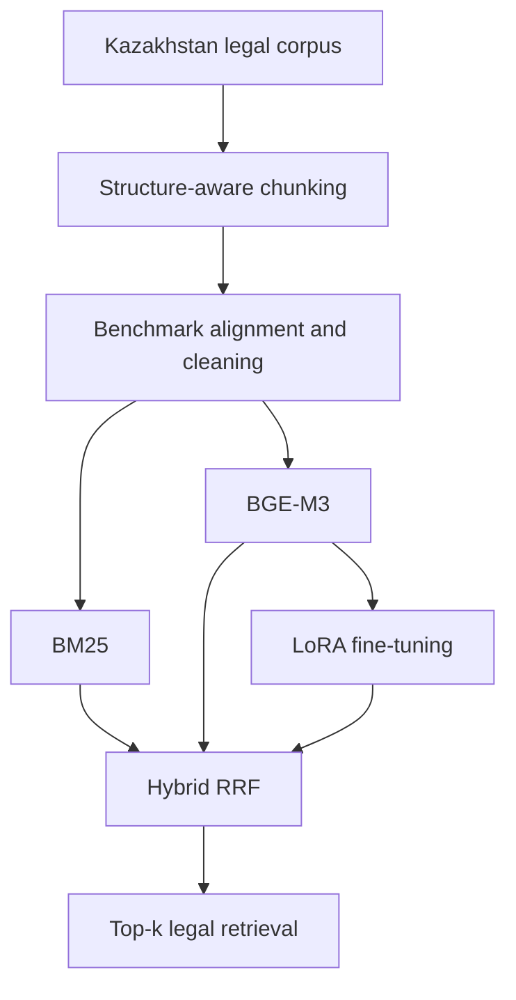
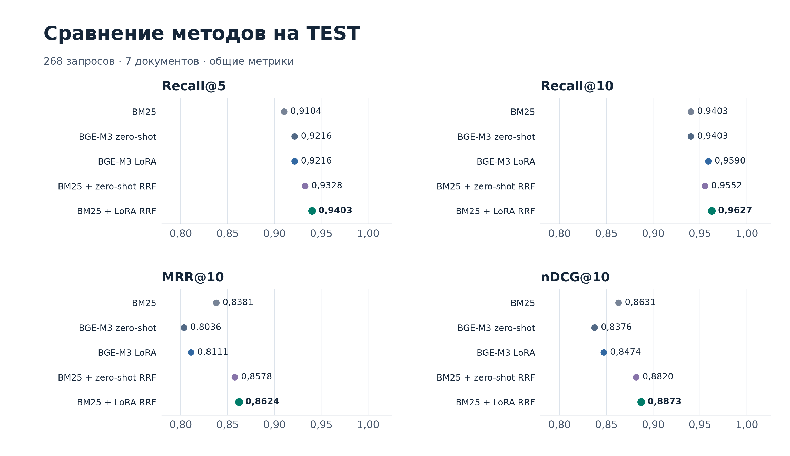

# KZ Document Intelligence

## Legal Semantic Search for Kazakhstan Legislation

A retrieval system for questions about Kazakhstan legislation in Russian and Kazakh. It ranks passages from legal documents and returns the top matches with their document IDs, article numbers, headings and excerpts.

### Current milestone

The baseline retrieval experiment is complete. It compares lexical, dense and hybrid retrieval on the same frozen benchmark. Model selection used DEV, followed by one final TEST evaluation.

### Pipeline



The hybrid combines BM25 with either zero-shot BGE-M3 or the fine-tuned adapter. RRF uses `K=60` and full rankings within the query language.

### Dataset

- **Corpus** — 20,000 bilingual legal records and 305,375 structure-aware chunks in RU and KK.
- **Frozen clean benchmark** — 1,087 TRAIN, 122 DEV and 268 TEST queries. Negative mining yielded 1,086 training records.
- **Fixed evaluation corpus** — seven verified documents and 3,009 chunks. Each query searches the chunks in its own language.

The public source datasets, preparation stages and local file layout are described in the [data guide](data/README.md).

### Final Results

| Method | Recall@5 | Recall@10 | MRR@10 | nDCG@10 |
|---|---:|---:|---:|---:|
| BM25 | 0.9104 | 0.9403 | 0.8381 | 0.8631 |
| BGE-M3 zero-shot | 0.9216 | 0.9403 | 0.8036 | 0.8376 |
| BGE-M3 LoRA | 0.9216 | 0.9590 | 0.8111 | 0.8474 |
| BM25 + zero-shot RRF | 0.9328 | 0.9552 | 0.8578 | 0.8820 |
| **BM25 + LoRA RRF** | **0.9403** | **0.9627** | **0.8624** | **0.8873** |

LoRA increased dense Recall@10 from **0.9403 to 0.9590**, or from 252 to 257 hits in 268 queries. **BM25 + LoRA RRF** led on all four aggregate metrics. Its Recall@10 was **0.9590 for RU** and **1.0000 for KK**. The KK TEST subset has only 24 queries, which limits conclusions about Kazakh retrieval.



### Fine-tuning

The experiment adapted `BAAI/bge-m3` with LoRA on an Apple M4 using PyTorch MPS. LoRA targeted the `query` and `value` projections. **Epoch 2** gave the first best DEV Recall@10 of **0.9918**. Early stopping ended training after epoch 4, following two epochs without improvement. [Checkpoint details](models/README.md)

### Demo

Use Python **3.13.2** and install the [pinned dependencies](requirements.txt) from the project root.

```bash
python3.13 -m venv .venv
source .venv/bin/activate
python -m pip install -r requirements.txt
```

With the exact local corpus and model artifacts in place, run the interactive **BM25 + LoRA RRF** demo.

```bash
python scripts/demo_search.py --interactive
```

The full demo needs `data/legal_chunks_20k.parquet`, the pinned BGE-M3 revision in the local Hugging Face cache, and the epoch-02 `adapter_config.json` and `adapter_model.safetensors` under `models/baseline_v1_lora/epoch-02/`. Dense modes require Apple Silicon with MPS. The interactive demo builds its indexes in memory before the first prompt. `--method bm25` works with the local corpus alone. The data and weights are kept outside this release. [Model setup](models/README.md#local-setup) · [Demo queries](results/baseline/demo_queries.md)

### Reproducibility

- [Experiment summary](results/baseline/experiment_summary.md)
- [Methodology](results/baseline/methodology.md) and [reproducibility notes with SHA-256 checksums](results/baseline/reproducibility.md)
- [Recorded experiment configuration](results/baseline/config.json), [DEV history](results/baseline/dev_history.csv), [DEV chart](results/baseline/dev_training_history.png) and [checkpoint selection](results/baseline/selection.json)
- [TEST results by method and language](results/baseline/metrics_table.csv), [full TEST JSON](results/baseline/test_metrics.json) and [Recall@10 by language](results/baseline/recall10_by_language.png)

The archived results are available directly from this repository. Re-running training and evaluation requires the exact local inputs listed in the [data guide](data/README.md#local-layout). The entry points for a new local run are `python -m scripts.train_bge_m3_lora` and, after DEV checkpoint selection, `python -m scripts.evaluate_test`.

### Limitations

- Evaluation covers a fixed corpus of seven verified documents. Results describe retrieval within that collection.
- KK TEST contains 24 queries. The language-specific numbers are descriptive.
- Question-to-passage alignment required repair and filtering. The resulting benchmark uses one gold chunk per question and may still contain edition mismatches.
- The released baseline covers retrieval. RAG remains outside the completed milestone.

### Ongoing Research

BiLegalAlign is an ongoing study of bilingual RU/KK provision alignment and structure-guided cross-lingual retrieval.

### Third-party resources

| Resource | Upstream license |
|---|---|
| [Kazakhstan Legal Corpus](https://huggingface.co/datasets/kurumikz/kazakhstan_legal_corpus), by `kurumikz` | ODC-BY 1.0, as stated in the dataset card |
| [Adilet Legal QA KZ](https://huggingface.co/datasets/olzhasAl/adilet-legal-qa-kz), by `olzhasAl` | Apache-2.0, as stated in the dataset card |
| [BAAI/bge-m3](https://huggingface.co/BAAI/bge-m3/tree/5617a9f61b028005a4858fdac845db406aefb181) | MIT |
| [PyTorch](https://github.com/pytorch/pytorch/blob/main/LICENSE), [NumPy](https://numpy.org/doc/stable/license.html), [pandas](https://github.com/pandas-dev/pandas/blob/main/LICENSE), [scikit-learn](https://github.com/scikit-learn/scikit-learn/blob/main/COPYING) | BSD-style core licenses. Bundled components may carry additional notices. |
| [Transformers](https://github.com/huggingface/transformers/blob/main/LICENSE), [PEFT](https://github.com/huggingface/peft/blob/main/LICENSE), [Accelerate](https://github.com/huggingface/accelerate/blob/main/LICENSE), [Hugging Face Hub](https://github.com/huggingface/huggingface_hub/blob/main/LICENSE), [Tokenizers](https://github.com/huggingface/tokenizers/blob/main/LICENSE), [PyArrow](https://github.com/apache/arrow/blob/main/LICENSE.txt), [rank_bm25](https://github.com/dorianbrown/rank_bm25/blob/master/LICENSE) | Apache-2.0 |
| [tqdm](https://github.com/tqdm/tqdm/blob/master/LICENCE) | MPL-2.0 and MIT notices as specified upstream |

These licenses apply to their respective third-party resources. A license for the project code has not been specified.
